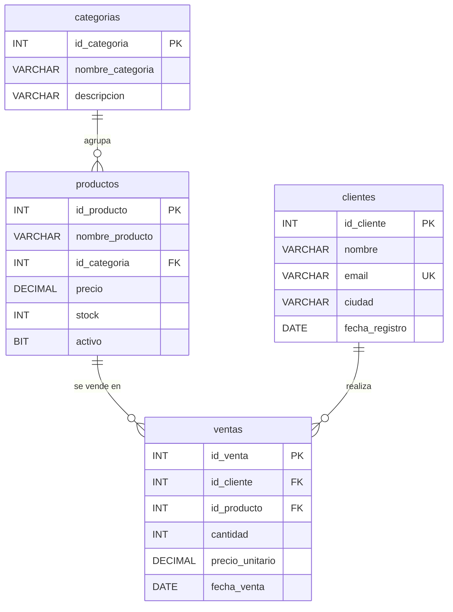

# Ventas_Tech_DB — Proyecto de Data Analytics

Proyecto integrador del curso de Data Analytics: un sistema de análisis completo para una empresa distribuidora de tecnología, desde el diseño de la base de datos hasta un dashboard ejecutivo en Power BI.

Este repositorio reúne las pre-entregas y checkpoints del curso, organizados por módulo.

## Contexto

La empresa tiene datos de ventas, clientes y productos dispersos en planillas de Excel que nadie analizó de forma sistemática. El objetivo del proyecto es responder una pregunta de negocio concreta:

> ¿Por qué cayeron las ventas en el último semestre frente al mismo período del año anterior, y qué combinación de región, categoría de producto y segmento de cliente explica esa caída?

Para responderla, el proyecto avanza en etapas: definición del problema, modelado de datos, construcción de la base en SQL, cruce de tablas, limpieza en Power Query y, al final, medidas DAX y un dashboard en Power BI.

## Estructura del repositorio

```
.
├── modulo-1/
│   └── Brief_RetailPro_M1.docx        # Problema de negocio, fuentes, preguntas, KPIs y boceto del dashboard
├── modulo-2/
│   ├── Modelo_Datos_RetailPro_M2.docx # Diagrama ER, diccionario de datos y justificación de 3NF
│   └── Diagrama_ER_RetailPro.png
├── modulo-3/
│   └── ventas_tech_db.sql             # Script que crea y carga Ventas_Tech_DB
└── README.md
```

## Modelo de datos (Módulo 3)

La base `Ventas_Tech_DB` sigue un esquema estrella normalizado hasta la Tercera Forma Normal (3NF): tres tablas de dimensión y una tabla de hechos.



| Tabla | Tipo | Qué representa | Registros |
|---|---|---|---|
| `categorias` | Dimensión | Agrupación de productos | 4 |
| `clientes` | Dimensión | Quiénes compran | 5 |
| `productos` | Dimensión | Qué se vende | 6 |
| `ventas` | Hechos | Las transacciones | 10 |

## Cómo ejecutar el script

**Requisitos:** SQL Server 2016 o superior y SQL Server Management Studio (SSMS).

1. Abre `modulo-3/ventas_tech_db.sql` en SSMS.
2. Ejecuta el script completo (F5).

El script crea la base si no existe, la selecciona, elimina las tablas previas, las vuelve a crear, carga los datos y corre las consultas de validación. Es repetible: se puede ejecutar varias veces seguidas sin errores.

### Secciones del script

| Sección | Qué hace |
|---|---|
| 0 — Base | Crea `Ventas_Tech_DB` si no existe y la selecciona |
| 1 — DROP | Elimina las tablas en orden inverso a las dependencias |
| 2 — CREATE | Crea las dimensiones primero y la tabla de hechos al final |
| 3 — INSERT | Carga los 25 registros respetando el orden de las claves foráneas |
| 4 — VALIDACIÓN | Cuenta las filas de cada tabla |

### Resultado esperado de la validación

| Consulta | Filas |
|---|---|
| `SELECT * FROM categorias;` | 4 |
| `SELECT * FROM clientes;` | 5 |
| `SELECT * FROM productos;` | 6 |
| `SELECT * FROM ventas;` | 10 |

## Decisiones de diseño

- **Precios en `DECIMAL(10,2)`, nunca `FLOAT`,** para evitar errores de redondeo al sumar miles de ventas.
- **Categorías en su propia tabla,** para que su nombre se guarde una sola vez y el modelo cumpla la 3NF.
- **Restricciones con nombre** (`PK_`, `FK_`, `UQ_`, `CK_`, `DF_`), para que los mensajes de error indiquen exactamente qué regla se violó.
- **`NOT NULL` en las claves foráneas,** porque una venta sin cliente o sin producto no tiene sentido de negocio.
- **Reglas `CHECK`:** la cantidad vendida debe ser mayor que 0, y los precios y el stock no pueden ser negativos.
- **`precio_unitario` en ventas:** registra el precio al momento de la venta, que puede diferir del precio actual del producto. No es redundante porque el total no se almacena.